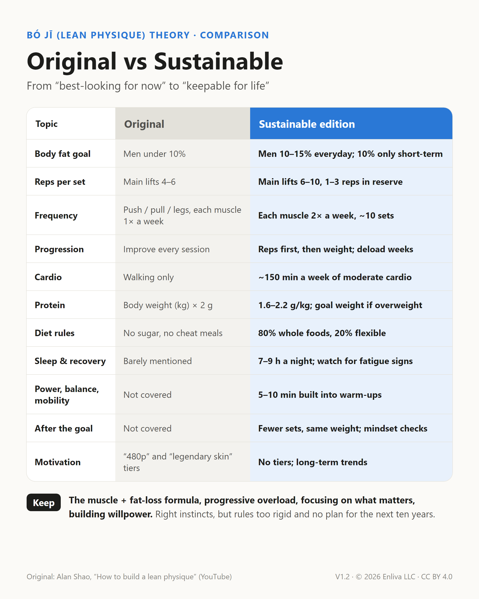

# The Sustainable Lean Physique Handbook: Bó Jī Theory, Sustainable Edition

[繁體中文](README.md) · [简体中文](README.zh-Hans.md) · **English**

A body that looks good, works well, and lasts: a practical training and lifestyle guide you can simply follow. Current version **V1.2**.

## Download

| Language | Handbook (A4 PDF) | Comparison card (for social media) |
| --- | --- | --- |
| English | [Sustainable-Lean-Physique-Handbook.pdf](en/Sustainable-Lean-Physique-Handbook.pdf) | [Original-vs-Sustainable.png](en/Original-vs-Sustainable.png) |
| 繁體中文 | [可持續薄肌手冊.pdf](zh-Hant/可持續薄肌手冊.pdf) | [原版vs可持續版.png](zh-Hant/原版vs可持續版.png) |
| 简体中文 | [可持续薄肌手册.pdf](zh-Hans/可持续薄肌手册.pdf) | [原版vs可持续版.png](zh-Hans/原版vs可持续版.png) |

## What this is

*Bó jī* (薄肌, literally “thin muscle”) is a Chinese-internet term for a lean, athletic look: enough muscle at a moderate body fat, so you look slim in clothes and fit without them. It's close to what English speakers call a *lean physique* or a *swimmer's build*. The idea is often called 薄肌理論, “bó jī theory.”

This handbook starts from the original bó jī theory, popularized by Chinese YouTuber Alan Shao (邵艾伦Alan). The original gets the big picture right (build muscle, lose fat, progressive overload, focus on what matters), but it's built for a short-term push. This edition rewrites it, following exercise guidelines and research, into something you can keep for life:

- No chasing extreme leanness: about 10–15% body fat for men day to day; 10% only for short stretches.
- Train each muscle twice a week, about 10 sets; main lifts 6–10 reps, leaving 1–3 reps in reserve.
- Adds cardio (about 150 minutes of moderate activity a week), sleep and recovery, power, balance, and mobility.
- Flexible eating: 80% whole foods, 20% foods you enjoy; protein 1.6–2.2 g/kg (use goal weight if overweight).
- Adds a beginner program, a pain traffic light, a maintenance phase, and mindset warning signs.

## The original videos (in Chinese)

- Alan Shao, “How to build a lean physique: training, diet, and fat loss explained” (如何练出薄肌？训练、饮食、减脂一次讲透), from 7:39: https://www.youtube.com/watch?v=vQp8G-BHnI8&t=459s
- Alan Shao, “In conversation with Justin Sun: how young people can seize the AI era” (对话孙宇晨：年轻人如何抓住AI时代的机会？), from 3:12:05: https://www.youtube.com/watch?v=0Z-vhBvBmUY&t=11525s

## Contents

| Chapter | Topic |
| --- | --- |
| Before you start | How to use the handbook, pre-exercise check, the pain traffic light |
| 1 | The goal: what a lean physique is, body fat guide, waist check |
| 2 | Train six things, but not equally |
| 3 | Strength training: five rules |
| 4 | Pick a program: beginner full body, standard 3-day, advanced 4-day |
| 5 | Cardio |
| 6 | Power, mobility, and balance |
| 7 | Putting the week together |
| 8 | Eating |
| 9 | Sleep and recovery |
| 10 | Tracking progress |
| 11 | Maintenance and mindset |
| Appendix | One-page cheat sheet, source videos |

## Repository layout

| Path | What |
| --- | --- |
| `en/`, `zh-Hant/`, `zh-Hans/` | Handbook PDF and comparison card in each language |
| `src/<lang>/handbook.html` | Handbook source; all figures are inline SVG |
| `src/<lang>/comparison.html` | Comparison card source |
| `tools/zh_hans.py` | Generates the Simplified Chinese source from Traditional (OpenCC plus a mainland terminology table) |
| `build.sh` | Rebuilds all PDFs and cards with headless Chrome |

To edit: change `src/zh-Hant/` and `src/en/` → run `python tools/zh_hans.py` → run `./build.sh`.

## Changelog

- **V1.2** (2026-10-12): Supplements section adds “Skip these” (BCAAs, fat burners, “testosterone boosters”) and safety notes (daily caffeine limit, third-party testing seals).
- **V1.1** (2026-10-12): Added Simplified Chinese and English editions; added links to the original videos; credit changed to Enliva LLC; CC BY 4.0 license.
- **V1.0** (2026-10-12): First release, Traditional Chinese.

## License

Everything in this repository (handbook, cards, sources) is released under [CC BY 4.0](LICENSE). You may share, translate, and adapt it, including commercially, as long as you give credit and note any changes.

Suggested credit:

> *The Sustainable Lean Physique Handbook* V1.2, Enliva LLC, CC BY 4.0, https://github.com/enlivatech/sustainable-lean-physique

## Disclaimer

This is a general fitness guide for healthy adults, not medical advice. If you have a medical condition, an old injury, are pregnant, or take regular medication, check with a doctor before you start.

© 2026 Enliva LLC
