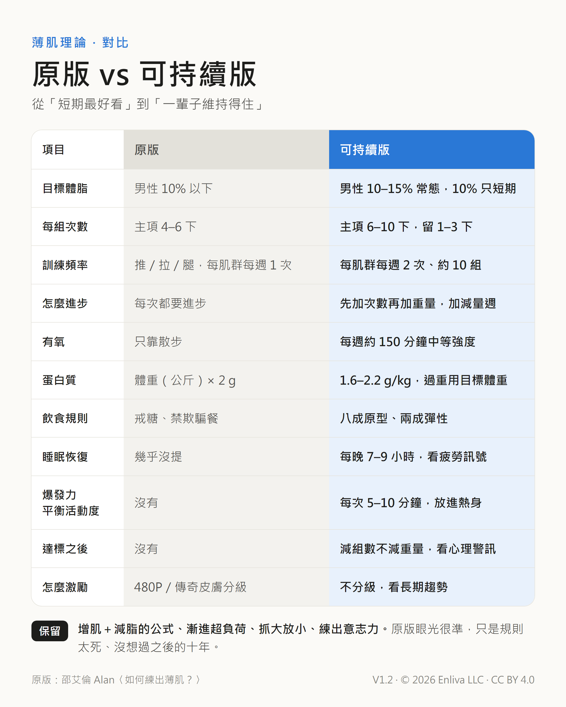

# 可持續薄肌手冊：薄肌理論可持續版

**繁體中文** · [简体中文](README.zh-Hans.md) · [English](README.en.md)

好看、好用、練得久的身體——一本照著做就行的訓練與生活指南。目前版本 **V1.2**。

## 下載

| 語言 | 手冊（A4 PDF） | 對比圖（社群分享用） |
| --- | --- | --- |
| 繁體中文 | [可持續薄肌手冊.pdf](zh-Hant/可持續薄肌手冊.pdf) | [原版vs可持續版.png](zh-Hant/原版vs可持續版.png) |
| 简体中文 | [可持续薄肌手册.pdf](zh-Hans/可持续薄肌手册.pdf) | [原版vs可持续版.png](zh-Hans/原版vs可持续版.png) |
| English | [Sustainable-Lean-Physique-Handbook.pdf](en/Sustainable-Lean-Physique-Handbook.pdf) | [Original-vs-Sustainable.png](en/Original-vs-Sustainable.png) |

## 這是什麼

「薄肌」指的是足夠的肌肉加上適中的體脂：穿衣顯瘦、脫衣有肉，不追求大塊頭。

這份手冊從「薄肌理論」的原版出發，也就是邵艾倫 Alan 在影片中提出的說法。原版抓重點的眼光很準（增肌加減脂、漸進超負荷、抓大放小），但目標偏向短期衝刺。這裡依照運動指南和研究改寫成能長期維持的版本：

- 體脂不追極低：男性常態 10–15%，10% 只在短期需要時壓一下。
- 每個肌群每週練 2 次、約 10 組，主項 6–10 下，每組留 1–3 下。
- 補上有氧（每週約 150 分鐘中等強度）、睡眠與恢復、爆發力、平衡、活動度。
- 飲食八成原型、兩成彈性，蛋白質 1.6–2.2 g/kg（過重用目標體重算）。
- 加入新手課表、疼痛紅綠燈、達標後的維持方法和心理警訊。

## 原版影片

- 邵艾倫 Alan〈如何練出薄肌？訓練、飲食、減脂一次講透〉，7:39 起：https://www.youtube.com/watch?v=vQp8G-BHnI8&t=459s
- 邵艾倫 Alan〈對話孫宇晨：年輕人如何抓住 AI 時代的機會？〉，3:12:05 起：https://www.youtube.com/watch?v=0Z-vhBvBmUY&t=11525s

## 目錄

| 章 | 內容 |
| --- | --- |
| 開始之前 | 怎麼用這本手冊、運動前自評、疼痛紅綠燈 |
| 1 | 目標：薄肌是什麼、體脂參考、腰圍指標 |
| 2 | 六件事都要練，但比重不同 |
| 3 | 重量訓練：五個原則 |
| 4 | 選一套課表：新手全身、標準三練、進階四練 |
| 5 | 有氧與心肺 |
| 6 | 爆發力、活動度、平衡 |
| 7 | 一週怎麼排 |
| 8 | 飲食 |
| 9 | 睡眠與恢復 |
| 10 | 追蹤進度 |
| 11 | 長期維持與心態 |
| 附錄 | 一頁速查卡、原版影片 |

## 檔案結構

| 路徑 | 說明 |
| --- | --- |
| `zh-Hant/`、`zh-Hans/`、`en/` | 三種語言的手冊 PDF 和對比圖 |
| `src/<語言>/handbook.html` | 手冊原始檔，圖表都是內嵌 SVG |
| `src/<語言>/comparison.html` | 對比圖原始檔 |
| `tools/zh_hans.py` | 從繁體原始檔產生简体版（OpenCC 加大陸用語對照表） |
| `build.sh` | 用 Chrome 重新產生三種語言的 PDF 和對比圖 |

改內容的流程：改 `src/zh-Hant/` 和 `src/en/` → 執行 `python tools/zh_hans.py` → 執行 `./build.sh`。

## 版本記錄

- **V1.2**（2026-10-12）：補充品一節加上「不必花錢的」（BCAA、燃脂劑、「提升睪固酮」補充品）和安全提醒（咖啡因每日上限、第三方檢驗標章）。
- **V1.1**（2026-10-12）：新增简体中文、英文版；加上原版影片連結；落款改為 Enliva LLC；CC BY 4.0 授權。
- **V1.0**（2026-10-12）：繁體中文版首次發布。

## 授權

本倉庫的內容（手冊、對比圖、原始檔）以 [CC BY 4.0](LICENSE) 授權釋出：可以自由轉載、翻譯、改編，商用也可以，只要標明出處並註明是否有修改。

標明出處的寫法，例如：

> 《可持續薄肌手冊》V1.2，Enliva LLC，CC BY 4.0，https://github.com/enlivatech/sustainable-lean-physique

## 聲明

本手冊是給一般成年人的健身指南，不取代醫療建議。有疾病、舊傷、懷孕或正在服藥，開始前先問醫生。

© 2026 Enliva LLC
