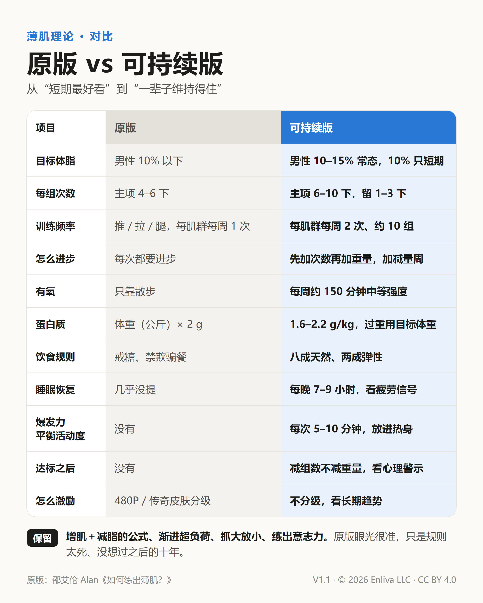

# 可持续薄肌手册：薄肌理论可持续版

[繁體中文](README.md) · **简体中文** · [English](README.en.md)

好看、好用、练得久的身体——一本照着做就行的训练与生活指南。目前版本 **V1.1**。

## 下载

| 语言 | 手册（A4 PDF） | 对比图（社交媒体分享用） |
| --- | --- | --- |
| 简体中文 | [可持续薄肌手册.pdf](zh-Hans/可持续薄肌手册.pdf) | [原版vs可持续版.png](zh-Hans/原版vs可持续版.png) |
| 繁體中文 | [可持續薄肌手冊.pdf](zh-Hant/可持續薄肌手冊.pdf) | [原版vs可持續版.png](zh-Hant/原版vs可持續版.png) |
| English | [Sustainable-Lean-Physique-Handbook.pdf](en/Sustainable-Lean-Physique-Handbook.pdf) | [Original-vs-Sustainable.png](en/Original-vs-Sustainable.png) |

## 这是什么

“薄肌”指的是足够的肌肉加上适中的体脂：穿衣显瘦、脱衣有肉，不追求大块头。

这份手册从“薄肌理论”的原版出发，也就是邵艾伦 Alan 在视频中提出的说法。原版抓重点的眼光很准（增肌加减脂、渐进超负荷、抓大放小），但目标偏向短期冲刺。这里依照运动指南和研究改写成能长期维持的版本：

- 体脂不追极低：男性常态 10–15%，10% 只在短期需要时压一下。
- 每个肌群每周练 2 次、约 10 组，主项 6–10 下，每组留 1–3 下。
- 补上有氧（每周约 150 分钟中等强度）、睡眠与恢复、爆发力、平衡、活动度。
- 饮食八成天然、两成弹性，蛋白质 1.6–2.2 g/kg（过重用目标体重算）。
- 加入新手课表、疼痛红绿灯、达标后的维持方法和心理警示。

## 原版视频

- 邵艾伦 Alan《如何练出薄肌？训练、饮食、减脂一次讲透》，7:39 起：https://www.youtube.com/watch?v=vQp8G-BHnI8&t=459s
- 邵艾伦 Alan《对话孙宇晨：年轻人如何抓住 AI 时代的机会？》，3:12:05 起：https://www.youtube.com/watch?v=0Z-vhBvBmUY&t=11525s

## 目录

| 章 | 内容 |
| --- | --- |
| 开始之前 | 怎么用这本手册、运动前自评、疼痛红绿灯 |
| 1 | 目标：薄肌是什么、体脂参考、腰围指标 |
| 2 | 六件事都要练，但比重不同 |
| 3 | 重量训练：五个原则 |
| 4 | 选一套课表：新手全身、标准三练、进阶四练 |
| 5 | 有氧与心肺 |
| 6 | 爆发力、活动度、平衡 |
| 7 | 一周怎么排 |
| 8 | 饮食 |
| 9 | 睡眠与恢复 |
| 10 | 追踪进度 |
| 11 | 长期维持与心态 |
| 附录 | 一页速查卡、原版视频 |

## 文件结构

| 路径 | 说明 |
| --- | --- |
| `zh-Hant/`、`zh-Hans/`、`en/` | 三种语言的手册 PDF 和对比图 |
| `src/<语言>/handbook.html` | 手册源文件，图表都是内嵌 SVG |
| `src/<语言>/comparison.html` | 对比图源文件 |
| `tools/zh_hans.py` | 从繁体源文件产生简体版（OpenCC 加大陆用语对照表） |
| `build.sh` | 用 Chrome 重新产生三种语言的 PDF 和对比图 |

改内容的流程：改 `src/zh-Hant/` 和 `src/en/` → 运行 `python tools/zh_hans.py` → 运行 `./build.sh`。

## 版本记录

- **V1.1**（2026-10-12）：添加简体中文、英文版；加上原版视频链接；落款改为 Enliva LLC；CC BY 4.0 授权。
- **V1.0**（2026-10-12）：繁体中文版首次发布。

## 授权

本仓库的内容（手册、对比图、源文件）以 [CC BY 4.0](LICENSE) 授权发布：可以自由转载、翻译、改编，商用也可以，只要标明出处并注明是否有修改。

标明出处的写法，例如：

> 《可持续薄肌手册》V1.1，Enliva LLC，CC BY 4.0，https://github.com/enlivatech/sustainable-lean-physique

## 声明

本手册是给一般成年人的健身指南，不取代医疗建议。有疾病、旧伤、怀孕或正在服药，开始前先问医生。

© 2026 Enliva LLC
